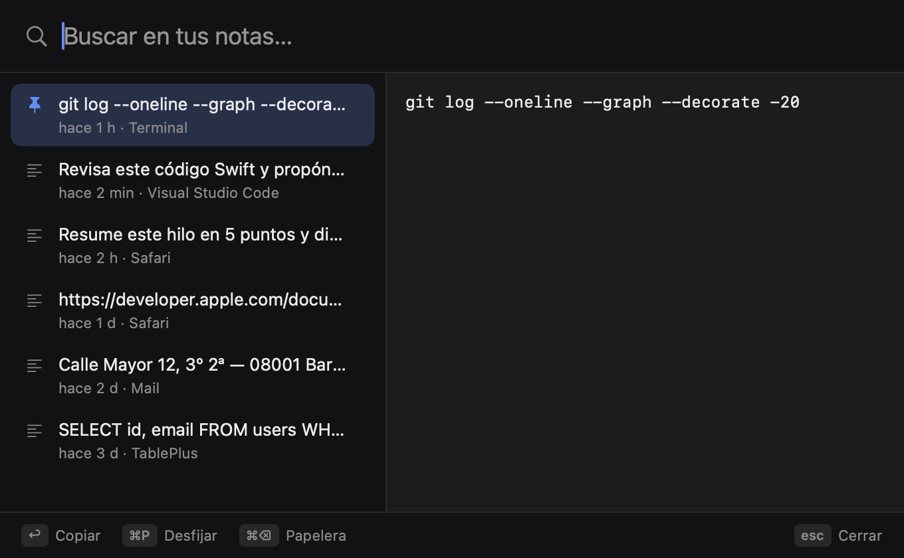
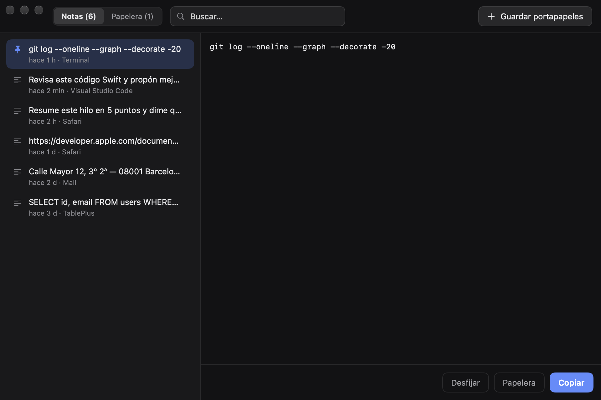
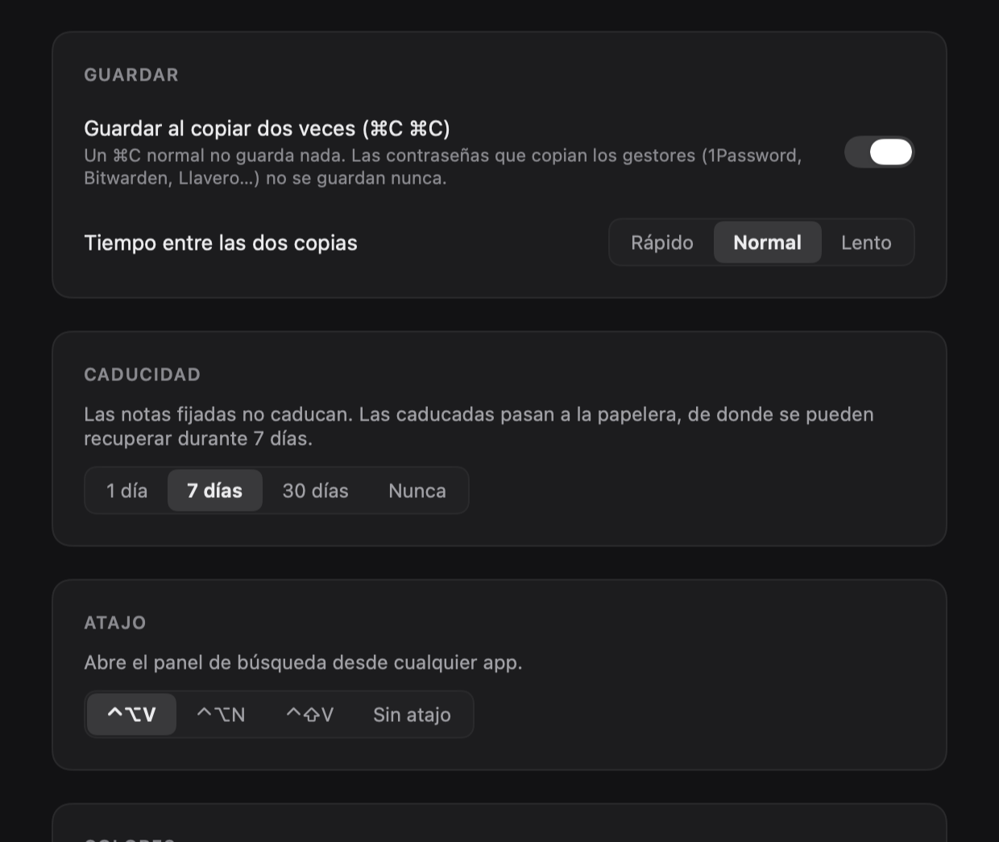

# Notity

Guarda lo que copias dos veces y recupéralo al momento.

## Instalar

Abre Terminal y pega:

```sh
curl -fsSL https://raw.githubusercontent.com/drarekx/Notity/main/install.sh | bash
```

El instalador descarga la última versión, la copia en `/Applications` y la abre. Notity vive en la barra de menús; no sale en el Dock.

Notity se actualiza sola: busca versiones nuevas al arrancar y una vez al día (o desde el menú → **Buscar actualizaciones…**), comprueba la descarga con su SHA-256 y se reinicia ya actualizada. Se puede desactivar en Ajustes. Volver a ejecutar el comando de instalación también actualiza.

**Instalación manual:** descarga `Notity.zip` de [Releases](https://github.com/drarekx/Notity/releases/latest), descomprímelo y mueve `Notity.app` a Aplicaciones. La app no está notarizada, así que la primera vez ábrela con clic derecho → **Abrir**.

Requisitos: macOS 14 (Sonoma) o posterior. Apple Silicon o Intel.

## Para qué sirve

Escribes un prompt, una dirección o un comando que no vas a usar ahora, lo copias… y al rato ya lo has machacado con otra cosa. Notity guarda **solo lo que copias dos veces seguidas** (⌘C ⌘C) y te lo devuelve con un atajo. Un ⌘C normal no guarda nada, así que lo que copias de paso (y las contraseñas) no se queda en ningún sitio.

## Cómo funciona

1. Selecciona un texto y pulsa **⌘C dos veces seguidas**. Junto al puntero aparece «Nota guardada» (y el icono de la barra hace un ✓).

<p align="center"></p>
2. Pulsa **⌃⌥V** desde cualquier app. Escribe para filtrar, muévete con ↑↓ y pulsa **↩**: la nota vuelve al portapapeles, lista para pegar.

<p align="center"></p>
3. **⌘P** fija una nota (no caduca nunca) y **⌘⌫** la manda a la papelera.
4. Las demás caducan solas (7 días por defecto) y pasan a la papelera, de donde se recuperan durante 7 días más.
5. Desde el menú de la barra → **Abrir Notity** ves todas las notas y la papelera.

<p align="center"></p>

En **Ajustes** decides si el doble ⌘C guarda, cuánto margen hay entre las dos copias, cuándo caducan las notas y el atajo.

<p align="center"></p>

## Todo lo que hace

- **Doble ⌘C para guardar**: sin permisos de Accesibilidad (mira el portapapeles, no el teclado). Margen entre las dos copias ajustable (rápido, normal, lento) o desactivable.
- **Funciona en iTerm2 y apps parecidas**: algunas apps no vuelven a copiar si el texto no ha cambiado, y Notity no ve el segundo ⌘C. En Ajustes → **Detectar ⌘C con el teclado** (pide el permiso de Monitorización de entrada) el doble ⌘C funciona en cualquier app. Notity solo mira si pulsas ⌘C, nunca lo que escribes.
- **Nunca guarda contraseñas**: ignora lo que 1Password, Bitwarden, el Llavero y otros gestores marcan como oculto.
- **Panel de búsqueda** con atajo global (⌃⌥V, ⌃⌥N, ⌃⇧V o ninguno), sin permisos.
- **Menú de la barra**: las últimas 5 notas a un clic y «Guardar portapapeles ahora».
- **Ventana de Notity**: todas las notas y la papelera, con búsqueda y vista previa.
- **Caducidad**: 1 día, 7 días, 30 días o nunca. Las fijadas no caducan. Copiar dos veces algo que ya estaba lo sube arriba en vez de duplicarlo.
- **Colores**: temas clásicos con sus colores oficiales (Solarized, Dracula, Nord, Gruvbox, Monokai, One Dark, Tokyo Night, Catppuccin, Rosé Pine, Everforest, Kanagawa, GitHub Dark) además del original.
- **Idiomas**: castellano, inglés y catalán.
- **Abrir al iniciar sesión**: se activa la primera vez que se abre desde Aplicaciones; se puede quitar en Ajustes.

¿Te es útil? [Invítame a un café](https://buymeacoffee.com/drarek) ☕

## Dónde guarda las cosas

- Notas: `~/Library/Application Support/Notity/notes.json` (solo lo puede leer tu usuario).
- Ajustes: `defaults read com.egluu.notity`

## Desinstalar

```sh
osascript -e 'quit app "Notity"'
rm -rf /Applications/Notity.app ~/Library/Application\ Support/Notity
defaults delete com.egluu.notity
```

## Compilar desde el código

```sh
git clone https://github.com/drarekx/Notity.git
cd Notity
./build-app.sh          # deja build/Notity.app y build/Notity.zip
open build/Notity.app
```

Con Xcode 16+ el binario es universal (arm64 + x86_64); solo con las Command Line Tools se compila para la arquitectura del Mac.

Para publicar una versión nueva, crea y sube una etiqueta; GitHub Actions compila la app y crea el release con el zip:

```sh
git tag v1.0.1 && git push origin v1.0.1
```
